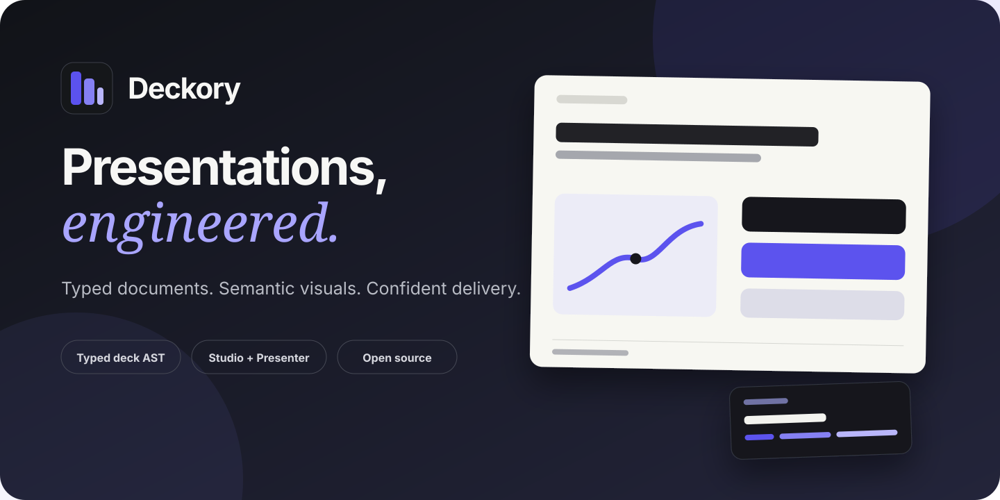

<div align="center">
  
  <h1>Deckory</h1>
  <p><strong>Presentations, engineered.</strong></p>
  <p>A code-native presentation system for building structured, validated and visually expressive decks.</p>

  <p>
    <a href="https://github.com/KanzuXHorizon/Deckory/actions/workflows/ci.yml"></a>
    <a href="https://github.com/KanzuXHorizon/Deckory/actions/workflows/codeql.yml"></a>
    <a href="LICENSE"></a>
    
    
    
  </p>
</div>



## Why Deckory

Most presentation tools treat slides as disconnected canvases. Deckory treats a deck as a **typed document system**: content is structured, validated and rendered through semantic components so the same source can power editing, previewing and presenting.

- **Structured by design** — decks use a typed AST instead of arbitrary layout code.
- **Semantic visuals** — charts, tables, comparisons, processes and code blocks communicate intent.
- **Presentation-ready** — keyboard navigation, reveal sequences, overview mode and private speaker notes are built in.
- **Safer iteration** — validation catches malformed documents before they reach the audience.
- **Agent-friendly** — repository skills provide explicit direction for narrative, visual quality and completeness.

## Product surfaces

| Surface | Purpose |
| --- | --- |
| **Hub** | Browse and manage available decks. |
| **Studio** | Edit a shared typed deck document in the browser. |
| **Preview** | Review the audience-facing result before presenting. |
| **Presenter** | Deliver with keyboard navigation, sequence reveals, overview and speaker notes. |

## Quick start

### Requirements

- Node.js 24 or newer
- pnpm 11.7.0 through Corepack

```bash
corepack enable
pnpm install --frozen-lockfile
pnpm dev
```

Open [http://localhost:3000](http://localhost:3000).

## Quality checks

```bash
pnpm lint
pnpm typecheck
pnpm test
pnpm build
```

The same checks run on every push and pull request through GitHub Actions.

## Architecture

```text
apps/present       Hub, Studio, Preview and Presenter
packages/schema    Typed deck contract and validation
packages/core      Presentation runtime and navigation behavior
decks              Versioned deck packages and reference content
.agents/skills     Deckory-specific design and completion guidance
```

Deck documents are created with `defineDeck`, use stable kebab-case IDs and compose named layouts with semantic components. See [`AGENTS.md`](AGENTS.md) for repository conventions.

## Design system for agents

Deck and slide work starts with [`.agents/skills/deckory-slide-director/SKILL.md`](.agents/skills/deckory-slide-director/SKILL.md). It defines standards for narrative, composition, charts, tables, code, evidence, motion, accessibility and screenshot-based review.

Supporting skills include:

- **Brandkit** — establishes a coherent identity direction when one does not exist.
- **GPT Taste** — increases visual range when a deck feels repetitive or generic.
- **Full Output Enforcement** — prevents placeholder slides and incomplete delivery claims.

The source and adaptation policy is recorded in [`.agents/taste-skill.lock.json`](.agents/taste-skill.lock.json).

## Current scope

Deckory currently includes a typed deck AST, validation, Hub, browser Studio, Preview, Presenter, speaker notes, sequence reveals, semantic charts, tables, code snippets and local draft persistence.

The following are intentionally outside the current boundary:

- real-time collaboration;
- cloud persistence and accounts;
- PDF, PNG and PPTX export.

This distinction is deliberate: the repository describes implemented behavior without presenting roadmap items as finished features.

## Community and support

- Read [`CONTRIBUTING.md`](CONTRIBUTING.md) before opening a pull request.
- Follow [`CODE_OF_CONDUCT.md`](CODE_OF_CONDUCT.md) in all project spaces.
- Use [`SUPPORT.md`](SUPPORT.md) for setup and issue-reporting guidance.
- Report vulnerabilities privately as described in [`SECURITY.md`](SECURITY.md).

## License

Deckory is available under the [MIT License](LICENSE).
